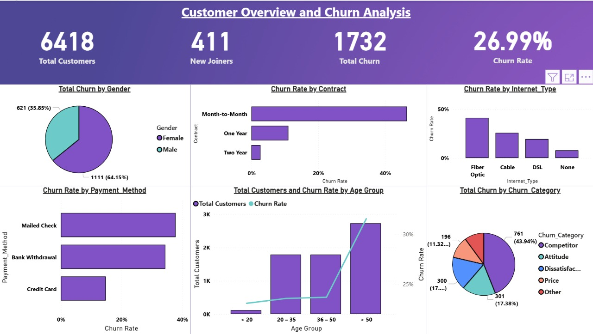
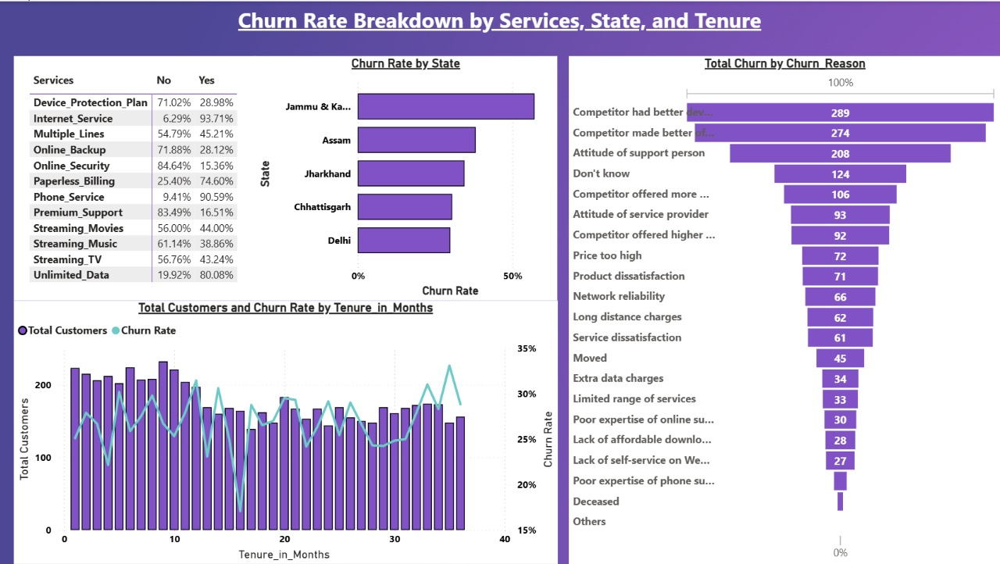
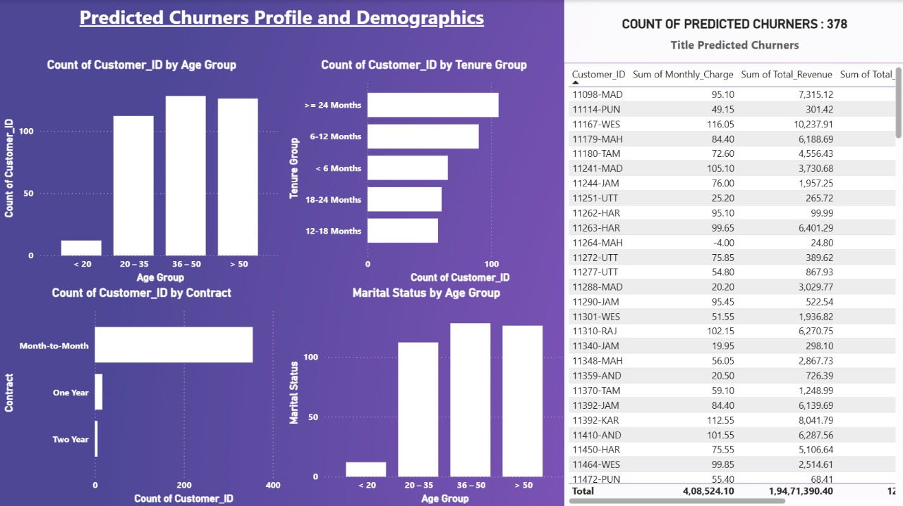

# Customer Churn & Retention Analytics

This project provides a comprehensive **Churn Analysis & Prediction** system using **Machine Learning** and **Power BI**. It allows business analysts to identify churn patterns, predict customer churn with high accuracy, and derive actionable insights to reduce attrition.

---

## 📊 Overview

- **Data Source**: Telco customer dataset
- **Tool Used**: Power BI, Python (sklearn, pandas, matplotlib), Excel
- **ML Model**: Random Forest Classifier (Accuracy: ~84%)
- **Key Output**: Predicted churn status added to raw customer data, visualized in a Power BI dashboard

---

## 🔍 Features

- Dynamic churn filtering by gender, age, service usage, etc.
- Predictive model integration with customer-level churn likelihood
- Easy-to-read visuals: pie charts, KPI cards, slicers, and trend lines
- Exportable predicted results with customer ID

---

## 🧠 Machine Learning Approach

- Preprocessed and encoded categorical data
- Trained a Random Forest model using scikit-learn
- Applied the model to new joiner data to predict churn
- Integrated predictions into Power BI

---







## 📁 File Structure

```bash
.
├── Prediction_Data.xlsx            # Excel input data
├── churn_prediction.py            # Model training and prediction script
├── Predictions.csv                # Output with predicted churn status
├── dashboard.pbix                 # Power BI dashboard file
└── README.md                      # This file


